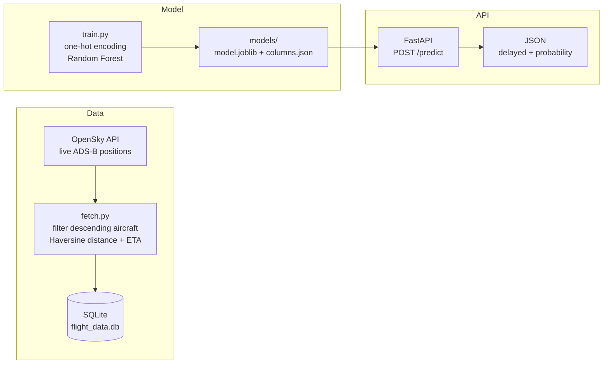

# ✈️ Munich Airport Flight Delay Predictor

A learning project that builds an end-to-end pipeline for predicting flight delays at
Munich Airport (MUC). It covers live flight data, feature engineering, model training
and a REST API.

> **Status:** the pipeline works end to end. The model is a **prototype trained on
> synthetic data**, so its predictions aren't meaningful yet. Training on real
> historical flights is the next step (see [Roadmap](#roadmap)).

**Why this project:** I work at Munich Airport and see every day how one late flight
knocks on through the rest of the day. I want to measure that and predict it with data.

## How it works



| Part | File | What it does |
|---|---|---|
| Live data | `src/fetch.py` | Pulls aircraft over Munich from the [OpenSky Network API](https://openskynetwork.github.io/opensky-api/), keeps airborne descending flights, adds distance to MUC (Haversine) and a straight-line ETA, and saves them to SQLite |
| Training | `src/train.py` | One-hot encodes hour, weather and airline, trains a scikit-learn `RandomForestClassifier` (80/20 split), and saves the model plus its column order |
| API | `app/main.py` | FastAPI service with input validation (Pydantic) that turns a flight into model features and returns a prediction |
| Tests | `tests/` | pytest tests for the API (health check, invalid input → 422) and the Haversine distance |
| Exploration | `01_data_exploration.ipynb` | The notebook where the pipeline was first prototyped |

## Quick start

```bash
python3 -m venv .venv
source .venv/bin/activate
pip install -r requirements.txt

python src/train.py              # creates models/model.joblib
uvicorn app.main:app --reload    # starts the API
```

Open **http://127.0.0.1:8000/docs** to try the API in your browser.

### Example request

```bash
curl -X POST http://127.0.0.1:8000/predict \
  -H "Content-Type: application/json" \
  -d '{"flight_hour": 18, "weather": "Snow", "airline": "EasyJet"}'
```

```json
{"delayed": false, "probability": 0.2}
```

| Field | Allowed values |
|---|---|
| `flight_hour` | 0–23 |
| `weather` | `Clear`, `Rain`, `Snow`, `Storm` |
| `airline` | `EasyJet`, `Lufthansa`, `Ryanair` |

Invalid input (for example `"weather": "Tornado"`) returns **422**.

### Fetch live Munich arrivals

```bash
python src/fetch.py
sqlite3 flight_data.db "SELECT callsign, distance_to_muc_km, eta_minutes FROM active_arrivals ORDER BY eta_minutes;"
```

Needs an internet connection. OpenSky rate-limits anonymous requests, so if you get
HTTP 429, wait a few minutes and try again.

### Run the tests

```bash
pytest
```

## Tech stack

| Area | Tools |
|---|---|
| Language | Python |
| Data | OpenSky REST API, requests, pandas, NumPy, SQLite |
| Machine learning | scikit-learn, joblib |
| API | FastAPI, Pydantic, Uvicorn |
| Quality | pytest, Ruff |

## Roadmap

- [x] Live arrivals from OpenSky with distance and ETA
- [x] Prototype model and training script
- [x] FastAPI prediction endpoint with input validation
- [x] Automated tests
- [ ] Train on real historical flights (scheduled vs. actual times)
- [ ] Add real Munich weather data
- [ ] Case study: how easyJet delays build up through the day at MUC
- [ ] Deploy on AWS

## About me

**Jeel Jivani**, M.Sc. Big Data & Business Analytics student (FOM) and Python backend developer, based in Munich.
